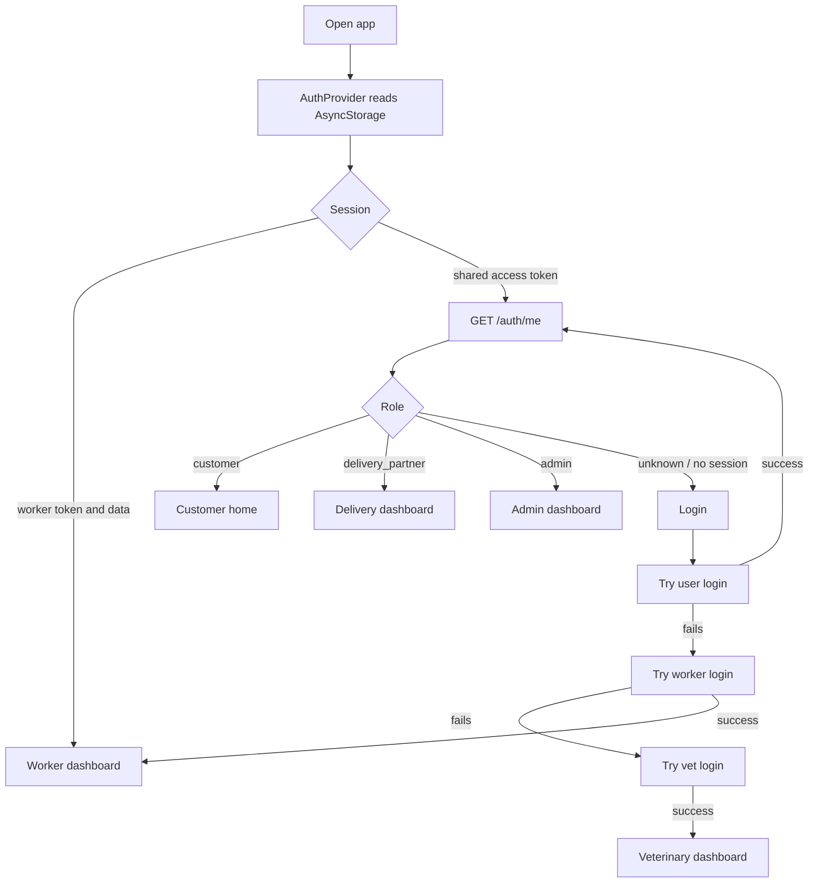
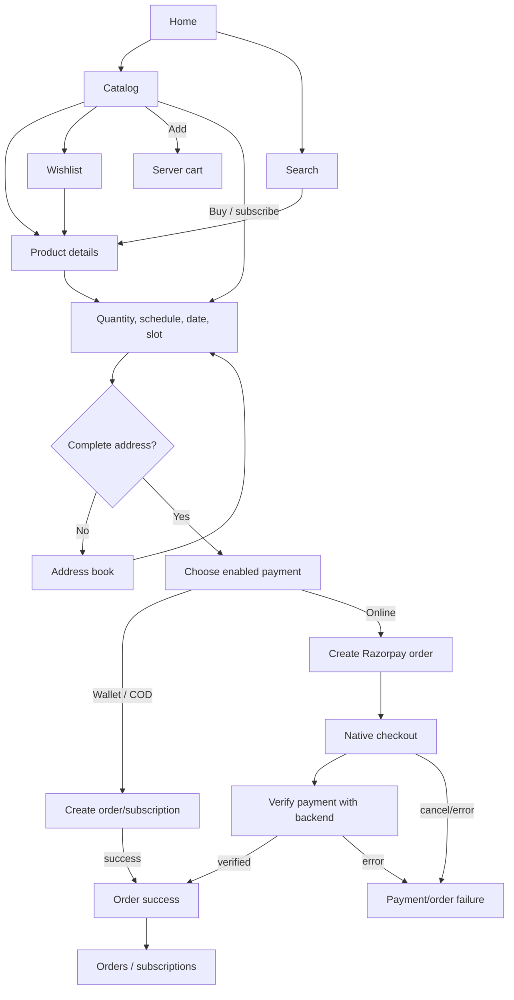
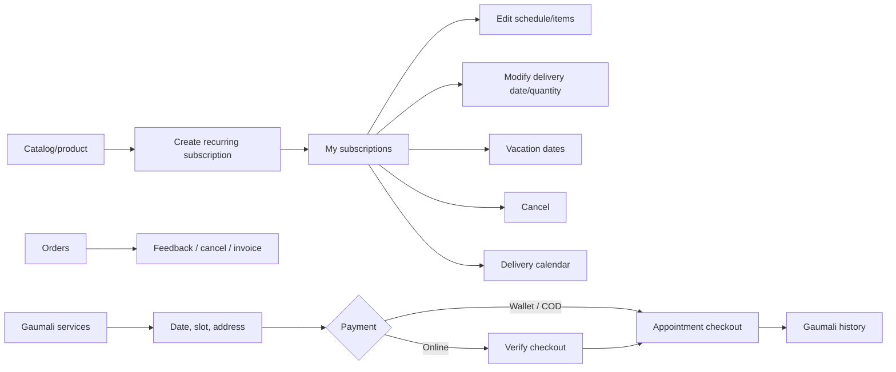
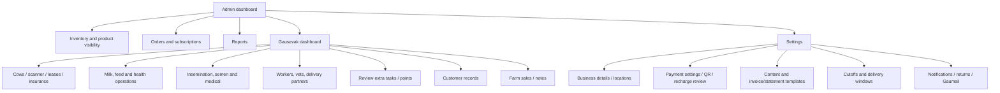
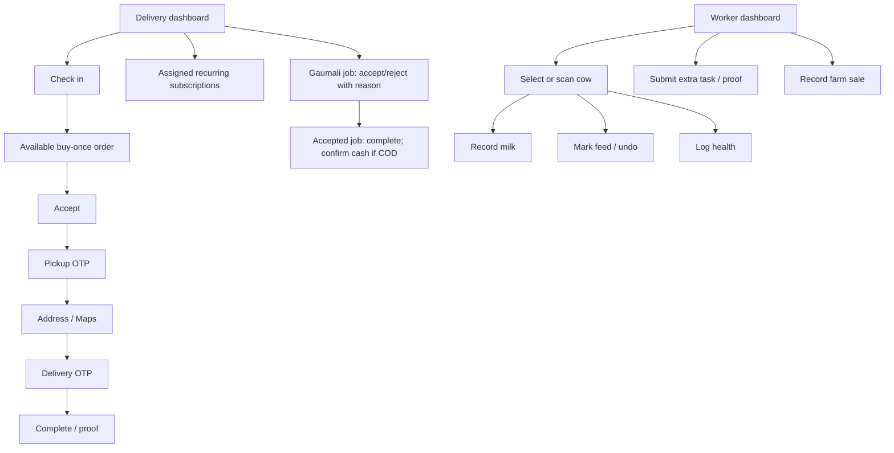

# Gau Satva Frontend

Production-oriented guide to the Expo / React Native frontend in this directory. It records behavior evidenced by frontend code, not a backend guarantee. A screen or service call proves only that the client implements an attempt; server availability, authorization and successful business outcomes require backend verification.

## Contents

- [Project summary](#project-summary)
- [Status conventions](#status-conventions)
- [Roles and navigation](#roles-and-navigation)
- [Feature inventory](#feature-inventory)
- [Application flows](#application-flows)
- [Architecture and shared behavior](#architecture-and-shared-behavior)
- [API integration inventory](#api-integration-inventory)
- [Configuration and environment](#configuration-and-environment)
- [Install, run, test, and build](#install-run-test-and-build)
- [Troubleshooting](#troubleshooting)
- [Limitations and unverified areas](#limitations-and-unverified-areas)
- [Glossary](#glossary)
- [Maintenance guide](#maintenance-guide)

## Project summary

Gau Satva is an Expo SDK 54, React 19, React Native 0.81 application using Expo Router file-based navigation and TypeScript. It includes customer commerce and subscriptions, farm administration, delivery-partner tools, worker daily farm tasks, and veterinary screens. The app entry is `expo-router/entry` in [package.json](package.json); root setup and role routing are in [app/\_layout.tsx](app/_layout.tsx) and [app/index.tsx](app/index.tsx).

| Item                                  | Verified value                                                                               |
| ------------------------------------- | -------------------------------------------------------------------------------------------- |
| Display name / current source version | Gau Satva / `1.0.23` ([app.json](app.json))                                                  |
| URL scheme                            | `gausatv`                                                                                    |
| Routing                               | Expo Router, file-based routes                                                               |
| Backend root                          | `${EXPO_PUBLIC_BACKEND_URL}/api`                                                             |
| Web                                   | Metro/static web output configured; native integrations are conditional/unavailable on web   |
| Native                                | Android project present; no `ios/` folder in this workspace listing; EAS profiles configured |

## Status conventions

| Label                    | Meaning                                                                                                                |
| ------------------------ | ---------------------------------------------------------------------------------------------------------------------- |
| **API-integrated**       | The screen invokes an explicit service/endpoint and handles returned data. Backend deployment/outcome is not verified. |
| **UI + local state**     | Interaction is implemented locally, without a verified server write.                                                   |
| **Partially integrated** | Mixes server/local behavior, has TODO/fallback behavior, or is platform/role limited.                                  |
| **Unverified**           | Suggested by navigation, copy or service definitions but implementation/server contract is incomplete or unclear.      |

Loading/empty/error wording below reflects explicit UI states where present; it does not imply every failure path is handled.

## Roles and navigation

### Authentication and role routing

`AuthProvider` restores shared sessions from AsyncStorage key `access_token`, then calls `/auth/me`. Worker sessions use `worker_token` and `worker_data`. Vet login stores `vet_token` and `vet_data` separately in [src/services/api.ts](src/services/api.ts), but the shared auth context does not restore or expose that session. Login tries shared-user authentication, then worker, then veterinary. At launch the root redirect prioritizes worker, then shared user roles `customer`, `delivery_partner`, and `admin`; missing or unknown roles go to login. Only the worker layout has an explicit role guard. Other layouts are navigators, not access-control boundaries; secure authorization must be enforced by the backend.

### Navigation map

Parentheses in Expo Router group names are organizational and are not URL segments. `href: null` routes are reachable from screen actions but hidden from the tab bar.

```text
Root Stack: root layout (SafeAreaProvider, AuthProvider, version modal, referral deep link)
├─ / → index route → role redirect
├─ /(auth) Stack: login; register → CustomerPhoneAccess component
├─ /(customer) Tabs: home, catalog, subscriptions (Orders), my-subscriptions,
│  gaumali, profile
│  Hidden: order-notifications, wallet, gaumali-history/details/cart, product-search,
│  wishlist, product-details, edit-profile, payment/order result screens, returns
├─ /(admin) Tabs: dashboard, inventory, orders, gausevak, wallet, settings
│  Hidden: extra-tasks, price-update, order-summary, order-cutoff, delivery-window,
│  gaumali, content, wallet-payment, app-settings, business-information,
│  invoice-template, statement-template, customer-manager, notification, returns
│  Gausevak nested Stack: cows, farmwork, customers, delivery-partners, feed, health,
│  index, insemination, insurance, leasing, medical, milkyield, notes,
│  scanner-result, semen, users, veterinary, workers, breeding-health
├─ /(delivery) Tabs: home, deliveries, subscriptions, gaumali, profile
│  Hidden: delivery-guidelines, contact-support, faqs, returns
├─ /(worker) guarded Stack: index (dashboard), milk, feed, health, farm-sale, settings
├─ /(veterinary) Stack: index, cow, farm, insemination, medical, semen
└─ /address-book: app/address-book.tsx (shared route, primarily customer flow)
```

Customer, admin and delivery tabs are declared in their respective role layouts; admin tabs wrap `NotificationProvider`; worker layout wraps `LanguageProvider`. Veterinary has a Stack layout but no auth/role guard.

## Feature inventory

### Shared and authentication

| Screen / source                                                                                                                                       | Purpose and interactions                                                                                               | Status, validation and state                                                                                                                                                                                                                                                                                                        |
| ----------------------------------------------------------------------------------------------------------------------------------------------------- | ---------------------------------------------------------------------------------------------------------------------- | ----------------------------------------------------------------------------------------------------------------------------------------------------------------------------------------------------------------------------------------------------------------------------------------------------------------------------------- |
| Launch — [app/index.tsx](app/index.tsx)                                                                                                               | Branded loader; waits for auth then routes by role. Data seeding is commented out and does not run.                    | Loading state; worker takes precedence over shared user.                                                                                                                                                                                                                                                                            |
| Login — [app/(auth)/login.tsx](<app/(auth)/login.tsx>)                                                                                                | Email or phone/password; sequential user → worker → vet login; forgot/reset password UI, wrong-password modal, toasts. | API-integrated. Indian phone check is 10 digits beginning 6–9; password required. Device push token is opportunistic.                                                                                                                                                                                                               |
| Registration — [app/(auth)/register.tsx](<app/(auth)/register.tsx>), [src/components/CustomerPhoneAccess.tsx](src/components/CustomerPhoneAccess.tsx) | Route re-exports phone OTP access: request/resend a six-digit code, change the number, then verify and continue.       | API-integrated; requires a 10-digit Indian mobile number, six-digit OTP, and 60-second resend timer. OTP delivery/policy are backend-dependent. Root layout forwards `register?referral_code=...`, but this route component does not read that parameter or implement a password-registration form; referral prefill is unverified. |
| Address book — [app/address-book.tsx](app/address-book.tsx)                                                                                           | Add/edit/remove address, labels/default, choose map position or current location, reverse-geocode, return to caller.   | API-integrated via profile update; requests foreground location permission; has default Ghaziabad-area map center. Route params support required-address and return destination.                                                                                                                                                    |

### Customer commerce and account

| Screen / source                                                                                                                                                                                                                                                                                                            | Purpose and interactions                                                                                                                                                                                                       | Status, validation and state                                                                                                                                                           |
| -------------------------------------------------------------------------------------------------------------------------------------------------------------------------------------------------------------------------------------------------------------------------------------------------------------------------- | ------------------------------------------------------------------------------------------------------------------------------------------------------------------------------------------------------------------------------ | -------------------------------------------------------------------------------------------------------------------------------------------------------------------------------------- |
| Home — [app/(customer)/home.tsx](<app/(customer)/home.tsx>)                                                                                                                                                                                                                                                                | Shortcuts, popular products/search terms, links to catalog/search, wallet, notifications and profile.                                                                                                                          | API-integrated; popular products and search history can fail independently.                                                                                                            |
| Catalog — [app/(customer)/catalog.tsx](<app/(customer)/catalog.tsx>)                                                                                                                                                                                                                                                       | Browse categories/products/content slides; product details, wishlist, cart, quantity, one-time/recurring purchase, service slot and payment choices. Displays stock, cutoff and delivery-window guidance; prompts for address. | API-integrated. Visibility status polled every 30 seconds while focused/active; catalog refresh on change. Native Razorpay unavailable in Expo Go/web.                                 |
| Search — [app/(customer)/product-search.tsx](<app/(customer)/product-search.tsx>)                                                                                                                                                                                                                                          | Product search/results, categories/history, quick-buy schedule and product navigation.                                                                                                                                         | API-integrated catalog fetch; fuzzy/phonetic ranking is local. No dedicated backend search endpoint was established from the screen code.                                              |
| Product detail — [app/(customer)/product-details.tsx](<app/(customer)/product-details.tsx>)                                                                                                                                                                                                                                | Product facts, image, rating/feedback, wishlist and buy/subscription sheet with quantity/pattern/days/date/slot/payment.                                                                                                       | API-integrated; loads product/feedback/cutoffs; address and cutoff restrictions can block checkout.                                                                                    |
| Wishlist — [app/(customer)/wishlist.tsx](<app/(customer)/wishlist.tsx>)                                                                                                                                                                                                                                                    | View/remove saved products, open details/catalog.                                                                                                                                                                              | API-integrated; loading and empty states.                                                                                                                                              |
| Orders — [app/(customer)/subscriptions.tsx](<app/(customer)/subscriptions.tsx>)                                                                                                                                                                                                                                            | Customer order history despite filename: search/filter, expand status/payment/items, cancel eligible order, feedback, partner/contact detail, invoice download/share.                                                          | API-integrated; refresh/loading/empty/error states. Cancel uses order DELETE; eligibility depends on screen status checks and server response.                                         |
| Subscriptions — [app/(customer)/my-subscriptions.tsx](<app/(customer)/my-subscriptions.tsx>)                                                                                                                                                                                                                               | Active/past recurring plans, details/calendar, item/schedule edit, date modification, vacation pause, resume/cancel where offered.                                                                                             | API-integrated with subscription, calendar and vacation methods; action eligibility is backend-dependent.                                                                              |
| Order calendar — [app/(customer)/order-notifications.tsx](<app/(customer)/order-notifications.tsx>)                                                                                                                                                                                                                        | Latest order state and calendar marks; select a delivery date to filter orders.                                                                                                                                                | API-integrated, snapshot-cached display and refresh.                                                                                                                                   |
| Wallet — [app/(customer)/wallet.tsx](<app/(customer)/wallet.tsx>)                                                                                                                                                                                                                                                          | Balance/transactions, filters, online recharge, manual QR/reference request when enabled, QR preview, statements/date range and bottle-deposit notice.                                                                         | API-integrated; payment/balance reads stay fresh. Native Razorpay needed for online payment.                                                                                           |
| Profile — [app/(customer)/profile.tsx](<app/(customer)/profile.tsx>), edit route [app/(customer)/edit-profile.tsx](<app/(customer)/edit-profile.tsx>)                                                                                                                                                                      | Profile/photo, addresses, order list, vacation UI, referral/Gaushala connection, logout.                                                                                                                                       | API-integrated for profile/photo/orders/connection. Vacation state is described in profile source as local state; do not assume persistence without validating its specific call path. |
| Payment/order results — [app/(customer)/payment-success.tsx](<app/(customer)/payment-success.tsx>), [app/(customer)/payment-failed.tsx](<app/(customer)/payment-failed.tsx>), [app/(customer)/order-success.tsx](<app/(customer)/order-success.tsx>), [app/(customer)/order-failed.tsx](<app/(customer)/order-failed.tsx>) | Display passed result parameters and navigate to wallet/catalog/orders. Success refreshes wallet best-effort for deposit notice.                                                                                               | Primarily UI from route params; these pages alone do not verify server settlement.                                                                                                     |
| Returns — [app/(customer)/returns.tsx](<app/(customer)/returns.tsx>), [src/components/ReturnsScreen.tsx](src/components/ReturnsScreen.tsx)                                                                                                                                                                                 | Shared customer return screen: eligible orders, return reason/kind, photo and request state.                                                                                                                                   | API-integrated; status and eligibility are backend-defined.                                                                                                                            |

### Customer Gaumali services

| Screen / source                                                                      | Purpose and interactions                                                                                                               | Status and state                                                                                                                                                                                       |
| ------------------------------------------------------------------------------------ | -------------------------------------------------------------------------------------------------------------------------------------- | ------------------------------------------------------------------------------------------------------------------------------------------------------------------------------------------------------ |
| Services/booking — [app/(customer)/gaumali.tsx](<app/(customer)/gaumali.tsx>)        | Browse service offerings, account-scoped local favorites/cart, details, future date/slot/address/payment, booking and history filters. | API-integrated via [src/services/gaumali.ts](src/services/gaumali.ts); validates future `YYYY-MM-DD`, complete address and native Razorpay availability. Pending checkout recovery uses local storage. |
| Details — [app/(customer)/gaumali-details.tsx](<app/(customer)/gaumali-details.tsx>) | Adapter for service detail/booking-first route params.                                                                                 | Reuses Gaumali UI.                                                                                                                                                                                     |
| Cart — [app/(customer)/gaumali-cart.tsx](<app/(customer)/gaumali-cart.tsx>)          | Review services, choose booking/payment details, checkout multiple services, recover payment state and open history.                   | API-integrated; cart/pending checkout stored locally; online mode requires native Razorpay.                                                                                                            |
| History — [app/(customer)/gaumali-history.tsx](<app/(customer)/gaumali-history.tsx>) | History-only adapter with status filters/details.                                                                                      | Reuses API-integrated Gaumali screen.                                                                                                                                                                  |

### Admin commerce and business operations

| Screen / source                                                                                                                                                                  | Purpose and interactions                                                                                                                                                                                      | Status and state                                                                                                                            |
| -------------------------------------------------------------------------------------------------------------------------------------------------------------------------------- | ------------------------------------------------------------------------------------------------------------------------------------------------------------------------------------------------------------- | ------------------------------------------------------------------------------------------------------------------------------------------- |
| Dashboard — [app/(admin)/dashboard.tsx](<app/(admin)/dashboard.tsx>)                                                                                                             | Overview from stats/products/customers/orders/subscriptions/recharge requests/feedback/notification counts; expandable panels and navigation to reports, orders and wallet.                                   | API-integrated, cached display snapshots, parallel fetches and optional-panel fallbacks.                                                    |
| Inventory — [app/(admin)/inventory.tsx](<app/(admin)/inventory.tsx>)                                                                                                             | Search, add/edit/delete products, upload images, price/MRP/stock/category/metadata/availability, adjust stock and view feedback/cutoff/window context.                                                        | API-integrated; alerts/snackbars; image picker; visibility hook reloads after status change.                                                |
| Price update — [app/(admin)/price-update.tsx](<app/(admin)/price-update.tsx>)                                                                                                    | Select products and submit bulk price edits.                                                                                                                                                                  | API-integrated bulk update.                                                                                                                 |
| Orders — [app/(admin)/orders.tsx](<app/(admin)/orders.tsx>)                                                                                                                      | Filter orders by status/date/product/customer, select/expand, assign partner, status/cancel and bulk actions; subscription management/calendar/vacation and feedback. Rider location/map links are also used. | API-integrated, cached lists and refresh. Permitted transitions depend on order state/server; maps need location or address.                |
| Order summary — [app/(admin)/order-summary.tsx](<app/(admin)/order-summary.tsx>)                                                                                                 | Product/order operational report.                                                                                                                                                                             | API-integrated fetch; report calculations local.                                                                                            |
| Cutoff — [app/(admin)/order-cutoff.tsx](<app/(admin)/order-cutoff.tsx>)                                                                                                          | CRUD general/product order cutoff schedules, time, days and active state.                                                                                                                                     | API-integrated; customer helper evaluates schedule locally; backend may still reject.                                                       |
| Delivery window — [app/(admin)/delivery-window.tsx](<app/(admin)/delivery-window.tsx>)                                                                                           | CRUD time ranges for general/product delivery windows.                                                                                                                                                        | API-integrated; catalog formats the promise locally.                                                                                        |
| Customer records — [app/(admin)/customer-manager.tsx](<app/(admin)/customer-manager.tsx>), [app/(admin)/gausevak/customers.tsx](<app/(admin)/gausevak/customers.tsx>)            | Merge offline customer records with app users; search name/phone/email/zone; active/linked/recent filters and sort; create/edit/delete offline record; zone/partner assignment; approve/reject claims.        | API-integrated; pages offline customers in batches of 200 up to 2,000. App-only users are read-only for offline-record CRUD. Name required. |
| Settings — [app/(admin)/settings.tsx](<app/(admin)/settings.tsx>)                                                                                                                | Hub for business/contact/profile, cutoff/delivery/grace controls, password OTP, share/referral, locations, payment/app settings, content/templates, notifications, returns, Gaumali and logout routes.        | Mixed API/local form state; dedicated screens persist settings.                                                                             |
| App settings — [app/(admin)/app-settings.tsx](<app/(admin)/app-settings.tsx>)                                                                                                    | Toggle Wallet, Online and COD; prevents disabling every method.                                                                                                                                               | API-integrated, optimistic update and rollback.                                                                                             |
| Business information — [app/(admin)/business-information.tsx](<app/(admin)/business-information.tsx>)                                                                            | Business name/support phone, business-location CRUD/primary location and password-confirmed account deletion.                                                                                                 | API-integrated; name/phone required.                                                                                                        |
| Content — [app/(admin)/content.tsx](<app/(admin)/content.tsx>)                                                                                                                   | Create/edit/delete and toggle active content cards with title/description/images used by catalog.                                                                                                             | API-integrated; image picker and base64/URL normalization.                                                                                  |
| Admin wallet — [app/(admin)/wallet.tsx](<app/(admin)/wallet.tsx>)                                                                                                                | Wallet and transaction/settlement data and bank/withdrawal UI where exposed.                                                                                                                                  | API-integrated; only rendered controls are considered functional, not every method in service.                                              |
| Wallet payment — [app/(admin)/wallet-payment.tsx](<app/(admin)/wallet-payment.tsx>)                                                                                              | Upload/update payment QR and label; filter recharge requests; approve/reject with note; view settlement summary.                                                                                              | API-integrated; label/image required; confirmation and refresh after actions.                                                               |
| Invoice/statement templates — [app/(admin)/invoice-template.tsx](<app/(admin)/invoice-template.tsx>), [app/(admin)/statement-template.tsx](<app/(admin)/statement-template.tsx>) | Edit branding, logo, business/contact, footer/terms and display options.                                                                                                                                      | API-integrated; statement service uses legacy wallet path after 404.                                                                        |
| Admin notifications — [app/(admin)/notification.tsx](<app/(admin)/notification.tsx>)                                                                                             | Inbox categories, mark individual/all read.                                                                                                                                                                   | API-integrated. Separate task summary poll is described in architecture.                                                                    |
| Admin returns — [app/(admin)/returns.tsx](<app/(admin)/returns.tsx>)                                                                                                             | Shared returns UI for review and partner/bottle workflows.                                                                                                                                                    | API-integrated; server controls allowed transitions.                                                                                        |

### Admin farm / Gausevak

Gausevak dashboard [app/(admin)/gausevak/index.tsx](<app/(admin)/gausevak/index.tsx>) shows cow totals, external Ghaziabad weather, daily task summary/notification modal, scanner and links to cows, farm work, breeding/health, extra tasks, user management, customers, orders and notes. Some existing screens below are direct/secondary routes rather than current dashboard menu links.

| Screen / source                                                                                                | Purpose and interactions                                                                                                                                                | Status and state                                                                                                           |
| -------------------------------------------------------------------------------------------------------------- | ----------------------------------------------------------------------------------------------------------------------------------------------------------------------- | -------------------------------------------------------------------------------------------------------------------------- |
| Cow registry — [app/(admin)/gausevak/cows.tsx](<app/(admin)/gausevak/cows.tsx>)                                | CRUD cows/bulls/newborns; tags, breed/family/dates/status, transfer/sale/expiry, photos, QR/barcode, locations, insurance/lease context; filters, scanner, print/share. | API-integrated; camera/media permissions.                                                                                  |
| Scanner result — [app/(admin)/gausevak/scanner-result.tsx](<app/(admin)/gausevak/scanner-result.tsx>)          | Find a cow from scanned tag, display details/contextual navigation.                                                                                                     | API-integrated list lookup; loader/no-match state.                                                                         |
| Farm work — [app/(admin)/gausevak/farmwork.tsx](<app/(admin)/gausevak/farmwork.tsx>)                           | Daily feed/milk task/log overview by date/shift and cow.                                                                                                                | API-integrated; loading/refresh states.                                                                                    |
| Milk yield — [app/(admin)/gausevak/milkyield.tsx](<app/(admin)/gausevak/milkyield.tsx>)                        | Admin milk entries and yield views.                                                                                                                                     | API-integrated; some external admin-dashboard links are not frontend features.                                             |
| Feed — [app/(admin)/gausevak/feed.tsx](<app/(admin)/gausevak/feed.tsx>)                                        | Feed inventory CRUD, purchase/use/adjust, alerts/transactions, cow feed status/logs, shift/date, defaults and mark/unmark.                                              | API-integrated; search/sort/filter and refresh.                                                                            |
| Health — [app/(admin)/gausevak/health.tsx](<app/(admin)/gausevak/health.tsx>)                                  | Review and update daily animal health status/logs.                                                                                                                      | API-integrated.                                                                                                            |
| Insurance — [app/(admin)/gausevak/insurance.tsx](<app/(admin)/gausevak/insurance.tsx>)                         | Cows/Alerts/Settings, policy CRUD, expiry/claim and notification settings/logs.                                                                                         | API-integrated; see service methods for notification operations; UI availability varies by rendered control.               |
| Breeding & Health hub — [app/(admin)/gausevak/breeding-health.tsx](<app/(admin)/gausevak/breeding-health.tsx>) | Links to insemination, semen and medical.                                                                                                                               | UI navigation only.                                                                                                        |
| Insemination — [app/(admin)/gausevak/insemination.tsx](<app/(admin)/gausevak/insemination.tsx>)                | Search/select cow, AI/natural record CRUD, pregnancy/PD/calving dates, sort/date filters.                                                                               | API-integrated; client form/date checks.                                                                                   |
| Semen — [app/(admin)/gausevak/semen.tsx](<app/(admin)/gausevak/semen.tsx>)                                     | Bull records, dose/outcome counters, conception rate, search/sort/date filters, edit/delete.                                                                            | API-integrated; counters cannot go below zero.                                                                             |
| Medical — [app/(admin)/gausevak/medical.tsx](<app/(admin)/gausevak/medical.tsx>)                               | Medical history/vaccine/deworming/issues/treatment plus medicine stock, purchase/use/adjust/transactions.                                                               | API-integrated; common issue/vaccine lists and calf schedule are UI aids, not clinical rules.                              |
| Leasing — [app/(admin)/gausevak/leasing.tsx](<app/(admin)/gausevak/leasing.tsx>)                               | Search farms, choose location/date/price/reason, create/edit/extend/complete/cancel cow leases.                                                                         | API-integrated; dates use DD/MM/YYYY helpers.                                                                              |
| Workers — [app/(admin)/gausevak/workers.tsx](<app/(admin)/gausevak/workers.tsx>)                               | Search/sort worker list, create/edit, designation/location/active, inspect/delete extra tasks and worker operations.                                                    | API-integrated, cached list and feedback.                                                                                  |
| Veterinary staff — [app/(admin)/gausevak/veterinary.tsx](<app/(admin)/gausevak/veterinary.tsx>)                | Vet account CRUD, active state, specialty/license/location assignment and password reset.                                                                               | API-integrated.                                                                                                            |
| Delivery partners — [app/(admin)/gausevak/delivery-partners.tsx](<app/(admin)/gausevak/delivery-partners.tsx>) | Partner CRUD, active state, credentials/contact/zone.                                                                                                                   | API-integrated; name/email required; new partner password required.                                                        |
| User hub — [app/(admin)/gausevak/users.tsx](<app/(admin)/gausevak/users.tsx>)                                  | Navigation to workers, vets and delivery partners.                                                                                                                      | UI-only hub.                                                                                                               |
| Customers — [app/(admin)/gausevak/customers.tsx](<app/(admin)/gausevak/customers.tsx>)                         | Detailed customer merge/CRUD/claim actions noted above.                                                                                                                 | API-integrated.                                                                                                            |
| Extra tasks — [app/(admin)/extra-tasks.tsx](<app/(admin)/extra-tasks.tsx>)                                     | Filter by date/status, inspect image proof, approve/reject with note, select worker and award/penalize points.                                                          | API-integrated; explicit summary/loading/empty/error states.                                                               |
| Farm sales — [farmsale.tsx](<app/(admin)/gausevak/farmsale.tsx>)                                               | View/filter totals and create/edit/delete worker sale data including payment/receipt.                                                                                   | API-integrated; media permission for receipt.                                                                              |
| Notes — [notes.tsx](<app/(admin)/gausevak/notes.tsx>)                                                          | Search, CRUD, pin, checklist content and PDF/share export.                                                                                                              | API-integrated CRUD; checklist encoding/PDF generation are local.                                                          |
| Gaumali admin — [app/(admin)/gaumali.tsx](<app/(admin)/gaumali.tsx>)                                           | Appointment filters/details, approve/reject/cancel, assign/reassign active Mali and complete.                                                                           | API-integrated; cash confirmation required for unpaid/COD completion; pending refunds are not automatically issued per UI. |

### Delivery partner

| Screen / source                                                                                                                                              | Purpose and interactions                                                                                                           | Status and state                                                        |
| ------------------------------------------------------------------------------------------------------------------------------------------------------------ | ---------------------------------------------------------------------------------------------------------------------------------- | ----------------------------------------------------------------------- |
| Dashboard — [app/(delivery)/home.tsx](<app/(delivery)/home.tsx>)                                                                                             | Shift check-in/check-out, status and order shortcuts.                                                                              | API-integrated; refresh/action feedback.                                |
| One-time deliveries — [app/(delivery)/deliveries.tsx](<app/(delivery)/deliveries.tsx>)                                                                       | Active/completed buy-once orders, accept/reject, pickup/delivery OTP, address/distance/maps and status confirmation.               | API-integrated; 4 OTP fields; rider location permission is best-effort. |
| Recurring deliveries — [app/(delivery)/subscriptions.tsx](<app/(delivery)/subscriptions.tsx>)                                                                | Assigned subscriptions with today/assigned/all/expired filters, schedule/address/status and maps.                                  | API-integrated; scheduled days are computed locally from plan pattern.  |
| Gaumali jobs — [app/(delivery)/gaumali.tsx](<app/(delivery)/gaumali.tsx>)                                                                                    | Open/completed/all service jobs, expand contact/address, accept/reject (reason max 500 chars), complete; COD requires cash toggle. | API-integrated; assignment ID required; retry/loading/empty states.     |
| Profile — [app/(delivery)/profile.tsx](<app/(delivery)/profile.tsx>)                                                                                         | Profile/image editing, own orders, assigned-admin contacts, support links and logout.                                              | API-integrated; photo picker/crop and system links.                     |
| Returns — [app/(delivery)/returns.tsx](<app/(delivery)/returns.tsx>)                                                                                         | Shared return/bottle workflow in delivery role.                                                                                    | API-integrated; backend transitions unverified.                         |
| Guidelines / FAQs — [app/(delivery)/delivery-guidelines.tsx](<app/(delivery)/delivery-guidelines.tsx>), [app/(delivery)/faqs.tsx](<app/(delivery)/faqs.tsx>) | Static delivery procedures and FAQ text.                                                                                           | UI-only copy; not an authoritative service policy.                      |
| Support — [app/(delivery)/contact-support.tsx](<app/(delivery)/contact-support.tsx>)                                                                         | Opens phone/email links.                                                                                                           | UI-only fixed external contacts.                                        |

### Worker

| Screen / source                                                        | Purpose and interactions                                                                                                    | Status and state                                                                                  |
| ---------------------------------------------------------------------- | --------------------------------------------------------------------------------------------------------------------------- | ------------------------------------------------------------------------------------------------- |
| Dashboard — [app/(worker)/index.tsx](<app/(worker)/index.tsx>)         | Cow/task dashboard, milk/feed/health/farm-sale quick actions, QR scan, extra task with optional proof image, points/status. | API-integrated worker endpoints; focus refresh; image permission.                                 |
| Milk — [app/(worker)/milk.tsx](<app/(worker)/milk.tsx>)                | Cow/shift selection, milk quantity entry, shift history/status and undo where shown.                                        | API-integrated; shift derives from local hour; alerts/errors.                                     |
| Feed — [app/(worker)/feed.tsx](<app/(worker)/feed.tsx>)                | Morning/evening mark/unmark feeding and status.                                                                             | API-integrated; English/Hindi strings.                                                            |
| Health — [app/(worker)/health.tsx](<app/(worker)/health.tsx>)          | Cow health review/status/note for date.                                                                                     | API-integrated; cached/loading/error state.                                                       |
| Farm sale — [app/(worker)/farm-sale.tsx](<app/(worker)/farm-sale.tsx>) | Record/view/edit/delete sale with customer/product/quantity/price/date/payment and optional receipt; payment QR retrieval.  | API-integrated; media permission.                                                                 |
| Settings — [app/(worker)/settings.tsx](<app/(worker)/settings.tsx>)    | View session profile, open extra-task modal, toggle English/Hindi, confirm worker logout.                                   | Profile from worker session; LanguageContext is React state and was not found to persist to disk. |

### Veterinary

| Screen / source                                                                         | Purpose and interactions                                                                        | Status and state                                                                                                         |
| --------------------------------------------------------------------------------------- | ----------------------------------------------------------------------------------------------- | ------------------------------------------------------------------------------------------------------------------------ |
| Dashboard — [app/(veterinary)/index.tsx](<app/(veterinary)/index.tsx>)                  | Links to animals/farm/medical/insemination/semen, dismissible alerts and logout.                | Partially integrated: vet profile read locally; alert builder has TODO/placeholder behavior and uses general cow lookup. |
| Animals — [app/(veterinary)/cow.tsx](<app/(veterinary)/cow.tsx>)                        | Animal registry, all/active/inactive/sold filters, expand details, scanner.                     | API-integrated with vet cow service; cached/refresh/loading/empty UI.                                                    |
| Farm — [app/(veterinary)/farm.tsx](<app/(veterinary)/farm.tsx>)                         | Farm overview, animal health, milk/feed by shift; health update, milk add/delete and feed mark. | API-integrated; date is client “today”.                                                                                  |
| Insemination — [app/(veterinary)/insemination.tsx](<app/(veterinary)/insemination.tsx>) | Vet-visible cow selection and AI/natural breeding record CRUD/outcomes.                         | API-integrated; date/form validation and normalized errors.                                                              |
| Medical — [app/(veterinary)/medical.tsx](<app/(veterinary)/medical.tsx>)                | Medical, vaccine, deworming, treatment and issue history CRUD.                                  | API-integrated; presets/schedules are client aids, not clinical validation.                                              |
| Semen — [app/(veterinary)/semen.tsx](<app/(veterinary)/semen.tsx>)                      | Search/view/create/edit/delete semen records and conception rate.                               | API-integrated; non-negative counters.                                                                                   |

## Application flows

### Launch and authentication



Veterinary is the exception: its separate token is not restored by shared `AuthContext`, so cold-start behavior is incomplete.

### Browse and purchase



Cart helpers support either one subscription per cart item or one combined buy-once request. Online checkout requires native Razorpay and backend verification; client checkout return alone is not payment proof.

### Subscriptions, orders, and Gaumali



### Admin and farm operations



### Delivery and worker daily work



Veterinary dashboard leads to animal/farm, medical, insemination and semen modules. Its live alert feed is incomplete (see limitations).

## Architecture and shared behavior

### Folders

| Path                               | Responsibility                                                                                                                                |
| ---------------------------------- | --------------------------------------------------------------------------------------------------------------------------------------------- |
| [app/](app/)                       | Expo Router route files and role layouts.                                                                                                     |
| [src/components/](src/components/) | Shared buttons/inputs/cards/loading, product/order/feedback/returns, scanner, crop/map, slots, notifications, updates and gesture components. |
| [src/contexts/](src/contexts/)     | Auth, worker language, admin task-notification provider.                                                                                      |
| [src/hooks/](src/hooks/)           | Screen snapshots, rider location, product visibility polling, product-age clock.                                                              |
| [src/services/](src/services/)     | API client, notification/version checks, customer/admin Gaumali clients.                                                                      |
| [src/utils/](src/utils/)           | Address, date, geo, cache policy, fuzzy search, device token, cutoff/window, payment messaging and deposit notice.                            |
| [assets/](assets/)                 | Brand/farm/cow/bull/calf images, customer ad images and font.                                                                                 |
| [android/](android/)               | Native Android Gradle project.                                                                                                                |
| [scripts/](scripts/)               | Version bump, reset helper and focused cache test.                                                                                            |
| [types/](types/)                   | Razorpay and swipe-button module declarations.                                                                                                |

### Providers, state, cache and transport

Root hierarchy: `SafeAreaProvider` → `AuthProvider` → root `Stack`, version-check modal and referral deep-link handler. Admin tabs add `NotificationProvider`; worker stack adds `LanguageProvider`. Most feature state lives in screen React state; there is no configured Redux store. `zustand` is a dependency, but no app store using it was identified.

The shared [src/services/api.ts](src/services/api.ts) client builds `${EXPO_PUBLIC_BACKEND_URL}/api${path}`, attaches `Bearer access_token` when available, sends JSON by default, parses response errors (including FastAPI validation arrays), and defaults to a 45-second abort timeout. Multipart requests do not set JSON content type. HTTP 401 and selected 403 errors clear shared session keys. Worker/vet service methods often use direct fetch and their own tokens, so timeout/error behavior differs. Admin notifications and `gaumaliAdmin` also have dedicated transports.

`useCachedScreenState` snapshots are in-memory display cache, not disk/offline storage. Session IDs prevent old-user responses overwriting new session snapshots. API GET cache TTL and coalescing are controlled in [src/utils/readCachePolicy.ts](src/utils/readCachePolicy.ts): max 80 entries, serialized values under 500 KB, write/session/refresh invalidation; money/auth/payment/search/version/live status and cutoff/window settings stay uncached or short-lived. Catalog visibility polls every 30 seconds while focused and active. Admin task-completion summary polls every 60 seconds. No general offline mutation queue or websocket was found.

Gaumali favorites/cart and pending checkout use account-scoped AsyncStorage. Worker language and most screen state are in-memory. Common form validation is screen-local, not a shared schema framework; feedback uses native alerts, custom alerts, toasts and loaders.

### Shared components and integrations

Notable reusable components: `Button`, `Input`, `Card`, `LoadingScreen`, `ProductCard`, `NewProductBadge`, `WishlistToast`, `ServiceSlotPicker`, `ReturnsScreen`/`ReturnPhoto`, `Scanner`, `AnimalDetailModal`, `OrderHistoryList`, `OrderItemFeedback`, `StarRating`, `RecordSearch`, `NotificationBell`, `WalletHistoryFilter`, `SwipeToConfirm`, `CropModal`, `LeafletMap`, `FarmBackground`, `UpdateModal` and `CustomerPhoneAccess` (all in [src/components/](src/components/)).

External/native dependencies include Expo Camera/Vision Camera, Image Picker, Location, Notifications, Haptics, Clipboard, File System, Print, Sharing, Media Library, Linking, SVG, QR code, View Shot and native Razorpay. Google Maps opens via URL; admin farm weather uses `wttr.in`; both are external. Push registration requests a device FCM/APNs token where native configuration permits; admin task summary uses HTTP polling, not push/websocket delivery. Permission declarations are in [app.json](app.json); user permission can still be denied.

## API integration inventory

Paths below are **frontend-confirmed**: they appear as literals or dynamic templates in service code used by screens. `:id`/query names indicate constructed values. Most routes in [src/services/api.ts](src/services/api.ts) use the shared `access_token`; worker direct fetches use `worker_token`, veterinary direct fetches use `vet_token`. This is not an OpenAPI contract: backend availability, response semantics and authorization are unverified unless explicitly typed in frontend code.

| Domain / screens                                   | Method and endpoint path(s)                                                                                                                                                                                                                                                                                                                                                                                                                                                                                                                                                                                                                                                                                                                                                                                                                                                                                                                                                                                                                                                                     | Calling code and verified request facts                                                                                                                                                                                                                                                                             |
| -------------------------------------------------- | ----------------------------------------------------------------------------------------------------------------------------------------------------------------------------------------------------------------------------------------------------------------------------------------------------------------------------------------------------------------------------------------------------------------------------------------------------------------------------------------------------------------------------------------------------------------------------------------------------------------------------------------------------------------------------------------------------------------------------------------------------------------------------------------------------------------------------------------------------------------------------------------------------------------------------------------------------------------------------------------------------------------------------------------------------------------------------------------------- | ------------------------------------------------------------------------------------------------------------------------------------------------------------------------------------------------------------------------------------------------------------------------------------------------------------------- | ----------------------------------------------------------------------------------------------------------------------------------------------------------------------------------------------------------------------------------------- |
| Auth — login/register/profile                      | `POST /auth/login`, `/auth/register`, `/auth/customer/send-otp`, `/auth/customer/verify-otp`, `/auth/customer/initial-password`, `/auth/send-register-otp`, `/auth/verify-register-otp`, `/auth/check-duplicate`, `/auth/forgot-password`, `/auth/reset-password`, `/auth/change-password-otp`, `/auth/verify-change-otp`, `/auth/confirm-change-password`, `/auth/verify-firebase`, `/auth/connect-gaushala`; `GET /auth/me`, `/auth/assigned-admin`; `PUT /auth/profile`; `POST /auth/profile/photo`; `DELETE /auth/account`                                                                                                                                                                                                                                                                                                                                                                                                                                                                                                                                                                  | [src/services/api.ts](src/services/api.ts) / AuthContext/screens. Login body has email-or-phone, password, platform/device token. Profile is JSON; photo is multipart `file`; account delete sends password.                                                                                                        |
| Referral                                           | `GET /admin/referral/:code`, `/admin/referral-directory`                                                                                                                                                                                                                                                                                                                                                                                                                                                                                                                                                                                                                                                                                                                                                                                                                                                                                                                                                                                                                                        | Registration/profile/settings; code normalized uppercase in service.                                                                                                                                                                                                                                                |
| Catalog/products/rules                             | `GET /catalog/products?fresh&admin_id&category&_ts`, `/products?admin_id&category&fresh&_ts`, `/products/:id`, `/categories`, `/catalog/admins`, `/catalog/popular-products?admin_id`, `/catalog/product-visibility?admin_id`, `/catalog/content`, `/app-settings/catalog`, `/order-cutoffs/catalog?admin_id`, `/delivery-windows/catalog?admin_id`, `/catalog/products/:id/feedback`                                                                                                                                                                                                                                                                                                                                                                                                                                                                                                                                                                                                                                                                                                           | Catalog/home/search/inventory; inactive products filtered client-side. Cutoff/window rules are read for display/blocking.                                                                                                                                                                                           |
| Cart/wishlist                                      | `GET /cart`, `/wishlist`, `/wishlist/ids`; `PUT /cart`; `POST /cart/items`, `/wishlist/:product_id/toggle`; `DELETE /cart`, `/cart/items/:product_id`                                                                                                                                                                                                                                                                                                                                                                                                                                                                                                                                                                                                                                                                                                                                                                                                                                                                                                                                           | Customer catalog/wishlist; cart rows `{product_id,quantity}`.                                                                                                                                                                                                                                                       |
| Feedback                                           | `POST /feedback`; `GET /feedback/order/:order_id`, `/admin/feedback/order/:order_id`, `/admin/products/:id/feedback`, `/admin/feedback/summary`                                                                                                                                                                                                                                                                                                                                                                                                                                                                                                                                                                                                                                                                                                                                                                                                                                                                                                                                                 | Customer order/product feedback and admin order/dashboard/inventory. POST fields include order/product/rating/optional comment.                                                                                                                                                                                     |
| Customer orders/invoices                           | `POST /orders`; `GET /orders`, `/orders/:id`, `/orders/tomorrow/preview`, `/orders/subscription/:id/calendar`; `DELETE /orders/:id`; `GET /invoices/order/:id/download`, `/invoices/subscription/:id/download`                                                                                                                                                                                                                                                                                                                                                                                                                                                                                                                                                                                                                                                                                                                                                                                                                                                                                  | Customer orders/calendar; download payload declared filename/MIME/base64.                                                                                                                                                                                                                                           |
| Subscriptions/vacations                            | `GET /subscriptions`, `/subscriptions/history`, `/subscriptions/admin/all`, `/subscriptions/admin/vacations`, `/subscriptions/delivery/assigned`, `/subscriptions/vacations`, `/admin/orders/subscription/:id`; `POST /subscriptions`, `/subscriptions/:id/modify`, `/subscriptions/:id/accept`, `/subscriptions/vacations`; `PUT/PATCH/DELETE /subscriptions/:id`; `PATCH/DELETE /subscriptions/vacations/:id`; `PATCH /subscriptions/admin/:id/status`; `GET /orders/subscription/:id/calendar`; `POST /subscriptions/razorpay/order`, `/subscriptions/razorpay/verify`                                                                                                                                                                                                                                                                                                                                                                                                                                                                                                                       | Customer/admin/delivery screens. Create payload declares items, pattern/custom days, date range, delivery slot and payment fields. Date modify body `{date,quantity}`; vacation body `{start_date,end_date}`.                                                                                                       |
| Wallet/payment                                     | `GET /wallet`, `/wallet/transactions`, `/wallet/recharge-requests`, `/wallet/statement-template/current`, `/wallet/statement-template`, `/wallet/bank-account`, `/wallet/withdrawals`, `/wallet/razorpay/settlements/summary`, `/wallet/razorpay/account`, `/wallet/payment-qr`, `/wallet/payment-qr/mine`; `POST /wallet/recharge`, `/wallet/recharge-request`, `/wallet/razorpay/recharge-order`, `/wallet/razorpay/verify-recharge`, `/wallet/bank-account`, `/wallet/withdraw`; `PUT /wallet/razorpay/account`, `/wallet/statement-template`; `GET /wallet/statement/download?start_date&end_date`; `POST/PUT /wallet/payment-qr` multipart                                                                                                                                                                                                                                                                                                                                                                                                                                                 | Customer/admin wallet and wallet-payment. Recharge uses amount; manual request amount/reference; Razorpay verification carries three IDs/signature fields; QR file + label.                                                                                                                                         |
| Admin orders/finance/recharge                      | `GET /admin/dashboard`, `/admin/procurement`, `/admin/orders?status&date`, `/admin/finance?start_date&end_date`, `/admin/recharge-requests?status`; `PATCH /admin/orders/:id/cancel`, `/admin/orders/:id/status`; `PUT /admin/orders/:id/assign?partner_id`, `/admin/recharge-requests/:id`; `POST /admin/refund?user_id&amount&reason`, `/admin/generate-orders`                                                                                                                                                                                                                                                                                                                                                                                                                                                                                                                                                                                                                                                                                                                               | Admin dashboard/orders/reports/wallet-payment. Bulk order update is a client loop, not a bulk route. Refund/generate methods exist in service; callers are not established for every method.                                                                                                                        |
| Admin users/customers                              | `GET /admin/users?role`, `/admin/workers`, `/admin/veterinarians`, `/admin/delivery-partners`, `/admin/customers?zone&is_active&search&linked&skip&limit`, `/admin/customers/:id`; `POST /admin/workers`, `/admin/veterinarians`, `/admin/delivery-partners`, `/admin/customers`; `PUT /admin/workers/:id`, `/admin/veterinarians/:id`, `/admin/delivery-partners/:id`, `/admin/customers/:id`, `/admin/users/:id/zone`; `DELETE /admin/workers/:id`, `/admin/veterinarians/:id`, `/admin/delivery-partners/:id`, `/admin/customers/:id?hard=true`; `PATCH /admin/veterinarians/:id/password`; `POST /admin/customers/:id/approve-claim`, `/admin/customers/:id/reject-claim`                                                                                                                                                                                                                                                                                                                                                                                                                   | Admin user/customer modules. Offline customer listing pages at most 2,000 rows in 200-item pages and merges app users.                                                                                                                                                                                              |
| Admin settings/content/locations                   | `GET/PUT /app-settings/admin`; `GET /content/getContent`; `POST /content/addContent`; `PUT /content/updateContent/:id`, `/content/toggleStatus/:id`; `DELETE /content/deleteContent/:id`; `GET/POST /admin/locations`; `PUT/DELETE /admin/locations/:id`; `GET/PUT /invoices/admin/template`; `GET/PUT /invoices/admin/statement-template`                                                                                                                                                                                                                                                                                                                                                                                                                                                                                                                                                                                                                                                                                                                                                      | Settings/content/business/template screens. Template fallback on 404 uses `/wallet/statement-template`. Content methods and location methods are concrete service paths.                                                                                                                                            |
| Cutoffs/windows                                    | `GET/POST /order-cutoffs/admin`; `PUT/DELETE /order-cutoffs/admin/:id`; `GET/POST /delivery-windows/admin`; `PUT/DELETE /delivery-windows/admin/:id`                                                                                                                                                                                                                                                                                                                                                                                                                                                                                                                                                                                                                                                                                                                                                                                                                                                                                                                                            | Admin rule screens; create/update fields declared in [src/services/api.ts](src/services/api.ts).                                                                                                                                                                                                                    |
| Admin Gaumali notifications and daily farm reports | `GET /gausevak/notifications`; `PATCH /gausevak/notifications/:id/read`; `GET /admin/milk?date`, `/admin/milk/dashboard?date`, `/admin/feed?date&shift`, `/admin/health?date`                                                                                                                                                                                                                                                                                                                                                                                                                                                                                                                                                                                                                                                                                                                                                                                                                                                                                                                   | Daily farm dashboard/report helpers. Notification service methods are present in [src/services/api.ts](src/services/api.ts), but no active screen caller was found for the Gausevak-specific notification endpoints.                                                                                                |
| Admin notifications/notes/returns                  | `GET /notifications/admin/inbox?limit&category`, `/notifications/admin/summary`; `PATCH /notifications/admin/:id/read`, `/notifications/admin/read-all`; `GET /admin/notifications/summary`; Gausevak notification helpers also declare `GET /gausevak/notifications` and `PATCH /gausevak/notifications/:id/read`; `GET /notes/?search`; `POST /notes/`; `PUT /notes/:id`; `DELETE /notes/:id`; `PATCH /notes/:id/pin`; `GET /returns`, `/returns/orders`, `/returns/bottles/orders`, `/returns/:id/photo`; `POST /returns`, `/returns/bottles/collect`, `/returns/:id/bottle-damage`; `PATCH /returns/:id`; `PUT /returns/:id/photo`                                                                                                                                                                                                                                                                                                                                                                                                                                                          | Admin inbox and task poll are distinct services. Gausevak notification methods are service-defined; a screen caller was not confirmed. Returns are shared role UI; body details are method-specific in [src/services/api.ts](src/services/api.ts).                                                                  |
| Cow/breeding/lease                                 | `GET/POST /gausevak/cows`; `GET /gausevak/cows?search`; `PUT/DELETE /gausevak/cows/:id`; `PATCH /gausevak/cows/:id/promote`; `POST /gausevak/cows/:id/qr`; `GET/PUT/DELETE /gausevak/cows/:id/capacity`; `GET /gausevak/cows/:id/default-feed`, `/gausevak/cows/:id/milk-history?days`; `PUT /gausevak/cows/:id/default-feed`; `GET/POST /gausevak/inseminations`; `PUT/DELETE /gausevak/inseminations/:id`; `GET/POST /gausevak/semen`; `PUT/DELETE /gausevak/semen/:id`; `PUT /gausevak/bulls/:id/semen`; `POST /gausevak/bulls/:id/use-semen?doses_used`; `GET /gausevak/farms/search?query`, `/gausevak/farms/:admin_id/locations`, `/gausevak/leases?direction&status`, `/gausevak/leases/:id`; `POST /gausevak/cows/:id/lease`; `PUT /gausevak/leases/:id`, `/gausevak/leases/:id/extend`; `POST /gausevak/leases/:id/complete`, `/gausevak/leases/:id/cancel`                                                                                                                                                                                                                            | Admin Gausevak screens; lease create/update fields include farm, date, price, reason/location. QR linking may use cow update.                                                                                                                                                                                       |
| Medical/insurance/medicine                         | `GET/POST /gausevak/medical`; `GET /gausevak/medical?search&status`; `PUT/DELETE /gausevak/medical/:id`; `PUT /admin/health/:cow_id`; `GET/POST /gausevak/insurance`; `GET /gausevak/insurance?status&search`, `/gausevak/cows/:id/insurance`, `/gausevak/insurance/expiring?days`; `PUT/DELETE /gausevak/insurance/:id`; `PATCH /gausevak/insurance/:id/claim`; `GET /admin/insurance/summary`, `/admin/insurance/notifications?limit`, `/admin/insurance/notification-settings`; `PUT /admin/insurance/notification-settings`; `POST /admin/insurance/register-fcm-token?token`, `/admin/insurance/send-test-notification`; `GET/POST /gausevak/medicines`; `GET /gausevak/medicines/:id`, `/gausevak/medicines/summary`, `/gausevak/medicines/:id/transactions`, `/gausevak/medicine-transactions`, `/gausevak/medicines/alerts/low-stock`, `/gausevak/medicines/alerts/expiring?days`; `PUT/DELETE /gausevak/medicines/:id`; `POST /gausevak/medicines/:id/purchase`, `/gausevak/medicines/:id/adjust`, `/gausevak/medicines/use`                                                           | Admin medical/insurance and medicine inventory. Typed insurance/medicine/stock fields are in [src/services/api.ts](src/services/api.ts); backend policy remains unverified.                                                                                                                                         |
| Farm operations/stock/extra tasks                  | `GET /admin/feed?date&shift`, `/admin/milk?date`, `/admin/milk/dashboard?date`, `/admin/health?date`; `POST /admin/milk/entry`, `/admin/feed/mark`; `PUT /admin/feed/:cow_id?date&shift`; `GET /worker/feed?date&shift`, `/worker/health?date`; `POST /worker/feed`; `DELETE /worker/feed?cow_id&date&shift`; `GET /admin/extra-tasks?date&status`, `/admin/extra-tasks/:worker_id`; `POST /admin/extra-tasks/:id/verify?action&note`, `/admin/points/bonus`; `GET/POST /admin/farm-sales`; `GET /admin/farm-sales?date&worker_id&all_time`, `/farm-sales?search`; `PUT/DELETE /admin/farm-sales/:id`; `GET/POST /gausevak/feed-stocks`; `GET /gausevak/feed-stocks?search&category&low_stock&expired`, `/gausevak/feed-stocks/:id`, `/gausevak/feed-stocks/summary`, `/gausevak/feed-stocks/:id/transactions`, `/gausevak/feed-stock-transactions`, `/gausevak/feed-stocks/alerts/low-stock`, `/gausevak/feed-stocks/alerts/expiring?days`; `PUT/DELETE /gausevak/feed-stocks/:id`; `POST /gausevak/feed-stocks/:id/purchase`, `/gausevak/feed-stocks/:id/adjust`, `/gausevak/feed-stocks/use` | Admin farmwork/milk/feed/health/extra-task/sales screens. Worker-specific direct implementations below use worker token and are separate from shared `/worker/...` methods.                                                                                                                                         |
| Worker role APIs                                   | `POST /worker/auth/login`; `GET /worker/auth/me`, `/worker/cows`, `/worker/milk/shift-status`, `/worker/milk/today`, `/worker/feed?date&shift`, `/worker/health?date`, `/worker/extra-tasks/today`, `/worker/points` (tries slash/API-prefix variants), `/worker/farm-sale?date                                                                                                                                                                                                                                                                                                                                                                                                                                                                                                                                                                                                                                                                                                                                                                                                                 | all_time`, `/worker/payment-qr`, `/worker/products?category`, `/worker/products/:id`; `POST /worker/milk`, `/worker/feed`, `/worker/health`, `/worker/extra-tasks`, `/worker/farm-sale`; `PUT/DELETE /worker/farm-sale/:id`; `DELETE /worker/milk/:id`, `/worker/feed?cow_id&date&shift`, `/worker/extra-tasks/:id` | Direct fetch methods generally use `worker_token`. Milk body includes cow, quantity, shift/date; health includes status/note; sale fields declared in `FarmSaleCreate`. Points fallback means final endpoint is unresolved until runtime. |
| Vet role APIs                                      | `POST /vet/auth/login`; `GET /vet/auth/me`, `/vet/cows`, `/vet/milk-records`, `/vet/milk/today`, `/vet/feed-records`, `/vet/feed?date&shift`, `/vet/health-records`, `/vet/medical`, `/vet/insemination`, `/vet/semen?search`, `/vet/cow/:id/medicine`, `/vet/cow/:id/health`, `/vet/cow/:id/milk`, `/vet/cow/:id/feed`; `POST /vet/milk`, `/vet/feed`, `/vet/health-update`, `/vet/medical`, `/vet/insemination`, `/vet/semen`; `PUT/DELETE /vet/medical/:id`, `/vet/insemination/:id`, `/vet/semen/:id`; `DELETE /vet/milk/:id`, `/vet/feed?cow_id&date&shift`; `PUT /vet/medicine-records/:id`                                                                                                                                                                                                                                                                                                                                                                                                                                                                                               | Direct fetch methods use `vet_token`; fields for clinical records are typed in service methods. Some declared detail methods may not have visible screen callers.                                                                                                                                                   |
| Delivery APIs                                      | `GET /delivery/status`, `/delivery/today`, `/delivery/available`, `/delivery/my-orders`, `/delivery/subscription-orders?subscription_ids`, `/delivery/zone-request-status`; `POST /delivery/checkin`, `/delivery/checkout`, `/delivery/orders/:id/accept`, `/delivery/orders/:id/reject`, `/delivery/orders/:id/verify-pickup-otp`, `/delivery/orders/:id/verify-delivery-otp`, `/delivery/complete`, `/delivery/status-update`, `/delivery/request-zone-change`, `/delivery/subscription-status-update`                                                                                                                                                                                                                                                                                                                                                                                                                                                                                                                                                                                        | Delivery screens; shared methods usually use `access_token`, but reject uses `worker_token`. Complete body includes order ID/optional proof image; OTP bodies `{otp}`. Token mismatch requires backend/product-owner confirmation.                                                                                  |
| Customer/admin Gaumali                             | Customer `GET /gaumali/services`, `/gaumali/slots?service_id&date`, `/gaumali/appointments`; `POST /gaumali/appointments`, `/gaumali/appointments/:id/verify`, `/gaumali/appointments/:id/cancel`, `/gaumali/appointments/:id/payment-status`, `/gaumali/checkouts`, `/gaumali/checkouts/:id/verify`, `/gaumali/checkouts/:id/cancel`, `/gaumali/checkouts/:id/payment-status`, `/gaumali/checkouts/by-request/:id`; admin `GET /gaumali/admin/services`, `/gaumali/admin/appointments`, `/gaumali/admin/malis`; `POST /gaumali/admin/services`, `/gaumali/admin/malis`; `PUT /gaumali/admin/services/:id`; `PATCH /gaumali/admin/appointments/:id`                                                                                                                                                                                                                                                                                                                                                                                                                                             | [src/services/gaumali.ts](src/services/gaumali.ts) uses shared request. [src/services/gaumaliAdmin.ts](src/services/gaumaliAdmin.ts) uses access token directly. Appointment/checkout request fields are declared in these service files. Some customer cancel/status methods send POST with `{}` as implemented.   |
| Gaumali delivery                                   | `GET /gaumali/delivery/appointments`; `PATCH /gaumali/delivery/appointments/:id`                                                                                                                                                                                                                                                                                                                                                                                                                                                                                                                                                                                                                                                                                                                                                                                                                                                                                                                                                                                                                | Delivery Gaumali route directly calls shared `api.request`; body decision/assignment/reason/cash flag.                                                                                                                                                                                                              |
| Version/search/external                            | `GET /version/check?app_version&platform`; `GET/POST/DELETE /catalog/search-history`; external `GET https://wttr.in/Ghaziabad?...`                                                                                                                                                                                                                                                                                                                                                                                                                                                                                                                                                                                                                                                                                                                                                                                                                                                                                                                                                              | Version check is unauthenticated direct fetch; search history uses shared client; weather/Maps/system phone/email are not Gau Satva backend endpoints.                                                                                                                                                              |

#### Dynamic and unresolved endpoint notes

- Dynamic IDs/query strings above are templates, not claims about backend path matching. [src/services/api.ts](src/services/api.ts) appends `/api`; dedicated services construct the same prefix independently.
- Worker points tries `/api/worker/points`, its trailing-slash variant, and two variants without `/api`; the effective server route is unresolved.
- Statement-template service falls back to `/wallet/statement-template` only on 404 from `/invoices/admin/statement-template`.
- Gaumali customer methods use POST with an empty JSON body for some payment-status/cancel calls because of the helper implementation; verify this server contract before changing it.
- No backend source/OpenAPI fixture was inspected. Response contracts, role authorization, transaction guarantees and deployment availability remain unverified.

## Configuration and environment

| Variable                  | Purpose                                        | Safe example                  |
| ------------------------- | ---------------------------------------------- | ----------------------------- |
| `EXPO_PUBLIC_BACKEND_URL` | Backend origin; the API client appends `/api`. | `https://<your-backend-host>` |

No `.env.example` is present in the inspected frontend inventory. Keep local `.env` ignored and do not include credentials. `EXPO_PUBLIC_*` values are embedded in the application bundle and must contain no secrets. [eas.json](eas.json) defines development, preview and production profiles; preview/production configure a backend URL through build profile settings. Use secure EAS configuration for environment separation.

[app.json](app.json) declares the `gausatv` scheme, portrait orientation, Android camera/notification/location permissions, iOS camera/photo/location usage descriptions, and Expo Router/Notifications/Vision Camera/Location/date picker plugins. Android config references a Google Services configuration file; its availability was not verified in the supplied file listing. Configure required Firebase/APNs services securely before push-enabled native builds.

## Install, run, test, and build

Run from the frontend root. [package.json](package.json) declares Yarn 1.22.22, but [package-lock.json](package-lock.json) also exists; use the package manager established by the team and avoid gratuitously regenerating the other lockfile.

### Prerequisites

- Node.js plus npm/Yarn compatible with Expo SDK 54 (the project does not pin a Node engine in [package.json](package.json)).
- A reachable backend configured with `EXPO_PUBLIC_BACKEND_URL`.
- Android local build: Android Studio/SDK, emulator or USB device, Java/Gradle toolchain.
- iOS local build: macOS and Xcode. Windows can use EAS cloud builds; it cannot run a local Xcode build.
- Native development/production build for Razorpay and other custom native modules; Expo Go is not equivalent.

### Install and start

```bash
# Use the package manager your team uses (Yarn is declared by package.json)
yarn install
# Or use npm with the checked-in npm lockfile
npm install

npm start       # Expo / Metro development server
npm run web     # Expo web target
```

Local `.env` template (do not commit actual host credentials or secrets):

```dotenv
EXPO_PUBLIC_BACKEND_URL=https://<your-backend-host>
```

Set an origin, not a URL ending in `/api`. A physical device cannot reach its own `localhost`; configure a host/IP reachable on the device network. Restart Expo after changing public environment variables.

### Native builds and checks

```bash
npm run android                 # expo run:android, local native build/install
npm run ios                     # expo run:ios; macOS + Xcode only
npx eas build --platform android --profile preview
npm run build:android:release   # bumps app version, then EAS production build
npm run build:ios:release       # bumps app version, then EAS production build
npm run lint
node scripts/test-screen-cache.cjs
```

The preview EAS Android profile is configured for an internal APK. Release scripts call [scripts/bump-app-version.js](scripts/bump-app-version.js), which increments the patch and Android version code in [app.json](app.json); inspect that diff and EAS remote version settings before distribution. Root scripts do not define a comprehensive automated test suite; the cache test is focused.

Backend-connected features require valid account/role data. Online payment also requires backend payment setup and verification; do not add payment secrets to the client. Push needs native platform configuration and user permission. Camera/location/image features depend on device capability and permission. Web support does not imply parity for those native APIs.

## Troubleshooting

| Problem                                      | Checks                                                                                                                                                       |
| -------------------------------------------- | ------------------------------------------------------------------------------------------------------------------------------------------------------------ |
| API calls hit wrong host / network errors    | Confirm `EXPO_PUBLIC_BACKEND_URL`, omit `/api`, ensure the host is reachable from emulator/device, check firewall/TLS, restart Metro after env changes.      |
| Login then immediate unauthorized state      | Check `/auth/me`, token expiry and role. Shared client clears session on 401/selected 403. Worker and vet use separate token keys/transports.                |
| Veterinary session vanishes after restart    | Vet token is separate and not restored by `AuthContext`; current frontend limitation.                                                                        |
| Razorpay not available                       | Use native dev/production build, not Expo Go/web; verify native module and backend order/verify configuration.                                               |
| Camera/photo/location/push does not work     | Grant OS permission, verify app config/plugin and rebuild after native config changes.                                                                       |
| Android build missing Google services config | Supply the required Firebase configuration securely; check SDK/JDK/Gradle and Expo native dependency alignment.                                              |
| EAS uses different backend                   | Configure public URL for the selected build profile/environment and rebuild; value is bundled at build time.                                                 |
| Visibility change not immediate              | Product status polls at 30 seconds while catalog is focused/active; pull refresh/reopen for an immediate check.                                              |
| Request timeout after a write                | Default shared timeout is 45 seconds, with endpoint overrides. A timeout does not prove a write/payment failed; refresh before retrying to avoid duplicates. |
| Install changes lockfiles                    | Use one package manager consistently; project has both Yarn package-manager metadata and npm lockfile.                                                       |
| iOS command fails on Windows                 | Expected for local Xcode builds. Use EAS cloud build or test Android/web-compatible paths.                                                                   |

## Limitations and unverified areas

- Veterinary session restoration and route guarding are incomplete relative to worker/shared auth.
- Role route groups other than worker do not enforce role checks in their layout; backend authorization is essential.
- Profile vacation state is labeled pure local state even though subscription vacation APIs exist; verify the exact save flow before claiming durable behavior.
- Vet dashboard alert builder contains TODO/placeholder code, uses general cow lookup and only constructs a limited healthy-cow alert. Live ultrasound/cryo alerts are not implemented there.
- Some admin farm routes exist but are not present in the active Gausevak menu (insurance, farm sales, leasing, milk-yield and other secondary routes); screen existence does not prove discoverability. In addition, [src/components/ReturnsScreen.tsx](src/components/ReturnsScreen.tsx) sends an admin back action to `/(admin)/profile`, but there is no admin profile route in the inspected route tree.
- Delivery rejection uses `worker_token` while most delivery calls use shared `access_token`; confirm intended rider auth contract.
- Backend endpoints, response schemas, authorization, validation and real payment/return/refund/push outcomes were not independently verified; no backend source/OpenAPI was supplied.
- Web output is configured, but camera, location, push and Razorpay are conditional/native-only in key flows.
- External weather, Maps, phone/email links, sharing and device apps depend on third-party/device/network availability.
- No general offline write queue or end-to-end automated test suite was found in root scripts.
- `.env` and account credentials are intentionally not reproduced; the listing has no `.env.example`. Android Firebase config availability was not verified.

## Glossary

| Term                     | Meaning here                                                                   |
| ------------------------ | ------------------------------------------------------------------------------ |
| Gausevak / Worker        | Farm staff recording milk, feed, health, extra tasks and sales.                |
| Delivery partner         | Rider account handling shifts, orders and delivery OTPs.                       |
| Veterinary / Vet         | Clinical staff area for animal/farm, medical, breeding and semen records.      |
| Gaumali / Mali           | Service appointments and the service-worker terminology used in those screens. |
| Buy once                 | One-time order pattern; the delivery OTP queue filters to this pattern.        |
| Cutoff / delivery window | Product ordering restriction and delivery-time guidance, respectively.         |
| Screen snapshot          | In-memory display cache, not durable offline storage.                          |
| Native build             | Development/production app containing native modules, unlike Expo Go.          |

## Maintenance guide

1. Add a route under the correct `app/(role)/` group, register it in the layout when needed, and document its real navigation entry points.
2. Prefer typed service methods over inline fetches. Document token key, endpoint, payload, timeout and error behavior when adding integrations.
3. Treat all `EXPO_PUBLIC_*` values as public; never bundle passwords, private keys, signing secrets or privileged credentials.
4. Review [src/utils/readCachePolicy.ts](src/utils/readCachePolicy.ts) when adding reads. Keep auth, payments, balances and live status fresh; ensure writes/session changes invalidate stale data.
5. Maintain permission explanations, accessibility roles/labels/states and Android/iOS safe-area/keyboard behavior. OS permission declaration does not imply user approval.
6. Keep server-side payment verification and retry/recovery paths; native checkout success alone is not settlement proof.
7. Review version/code changes made by release scripts and EAS remote version settings before distribution.
8. Validate with `npm run lint`, `node scripts/test-screen-cache.cjs`, plus platform-specific checks relevant to the change. Document only source-backed behavior; label backend-dependent behavior as unverified.
